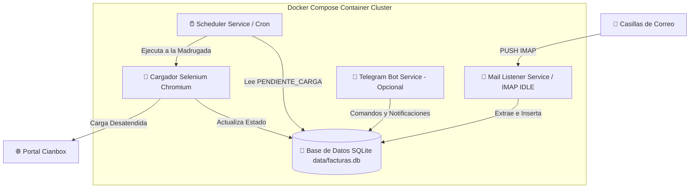

# 🤖 Automatización de Procesamiento y Carga Nocturna de Facturas

Sistema integral desacoplado y containerizado diseñado para ejecutar de forma continua (24/7) en un servidor o **Raspberry Pi 4**. Extrae comprobantes desde casilla de e-mail o archivos PDF, valida la información contable/fiscal, almacena el estado en una base de datos **SQLite** y realiza la inyección desatendida en **Cianbox** durante la noche.

---

## 🏗️ Arquitectura del Sistema (Microservicios)

El sistema utiliza una arquitectura por capas de microservicios desacoplados en Docker Compose que comparten el volumen de la Base de Datos SQLite:



### Componentes Principales

| Servicio / Componente | Ubicación / Archivo | Descripción |
| :--- | :--- | :--- |
| **Mail Listener (`mail_listener`)** | [`services/mail_listener.py`](file:///Users/fdelaplata/Documents/automatizacion-facturas/services/mail_listener.py) | Microservicio ultra liviano corriendo 24/7. Escucha eventos PUSH (IMAP IDLE) de N casillas y registra facturas en SQLite al instante. |
| **Programador Nocturno (`scheduler`)** | [`services/scheduler_service.py`](file:///Users/fdelaplata/Documents/automatizacion-facturas/services/scheduler_service.py) | Microservicio encargada de disparar la carga masiva en Cianbox según el horario guardado en SQLite. |
| **Base de Datos Compartida** | [`db/database.py`](file:///Users/fdelaplata/Documents/automatizacion-facturas/db/database.py) / [`db/models.py`](file:///Users/fdelaplata/Documents/automatizacion-facturas/db/models.py) | SQLite en `data/facturas.db` compartida entre contenedores mediante volúmenes de Docker. |
| **Parsers Multiproveedor** | [`parsers/base.py`](file:///Users/fdelaplata/Documents/automatizacion-facturas/parsers/base.py) / [`parsers/cromosol.py`](file:///Users/fdelaplata/Documents/automatizacion-facturas/parsers/cromosol.py) | Estructura extensible basada en el patrón Strategy. |
| **Enrutador / Dispatcher** | [`parsers/dispatcher.py`](file:///Users/fdelaplata/Documents/automatizacion-facturas/parsers/dispatcher.py) | Examina el PDF, identifica el proveedor e invoca el extractor adecuado. |
| **Containerización** | [`Dockerfile`](file:///Users/fdelaplata/Documents/automatizacion-facturas/Dockerfile) / [`docker-compose.yml`](file:///Users/fdelaplata/Documents/automatizacion-facturas/docker-compose.yml) | Definición del cluster de microservicios. |

---

## 💾 Esquema de Base de Datos (SQLite)

La base de datos se almacena en `data/facturas.db` y cuenta con las siguientes tablas:

* **`proveedores`**: Datos del emisor (`nombre`, `cuit`, `parser_type`).
* **`facturas`**: Cabecera del comprobante (`numero_comprobante`, `tipo_comprobante`, `fecha_emision`, `neto`, `iva`, `percepciones`, `total`, `estado`, `motivo_error`).
  * Estados posibles: `PENDIENTE_CARGA`, `CARGADA_CIANBOX`, `ERROR_PROCESAMIENTO`, `ERROR_CARGA`.
* **`factura_items`**: Detalle de productos (`codigo`, `descripcion`, `cantidad`, `precio_unitario`, `subtotal`).
* **`casillas_email`**: Credenciales y configuración de casillas de correo (`user`, `password`, `server`, `folder`, `activa`).
* **`configuracion_sistema`**: Parámetros globales editables en caliente (`HORA_CARGA_NOCTURNA`, `MINUTO_CARGA_NOCTURNA`, `TOLERANCIA_VALOR`).
* **`proceso_logs`**: Trazabilidad y auditoría de eventos.

---

## 🚀 Guía de Uso y Despliegue

### 1. Requisitos Previos

- Docker y Docker Compose instalados.
- Archivo `.env` configurado con tus credenciales iniciales.

Ejemplo de `.env`:
```ini
# Credenciales Email IMAP Iniciales (se migran automáticamente a SQLite)
EMAIL_SERVER=imap.gmail.com
EMAIL_USER_1=facturas@tubusiness.com
EMAIL_PASS_1=TuPasswordSegura
EMAIL_FOLDER_1=INBOX

# Credenciales Cianbox
CIANBOX_USER=tu_usuario
CIANBOX_PASS=tu_password
URL_LOGIN=https://sistema.cianbox.com/login
```

---

### 2. Despliegue con Docker Compose (Raspberry Pi / Servidor)

Para construir e iniciar todos los microservicios en background:

```bash
# Construir e iniciar los microservicios (mail_listener + scheduler)
docker compose up -d --build
```

Para monitorear los logs de cada servicio por separado:
```bash
# Logs del receptor de mails en tiempo real
docker compose logs -f mail_listener

# Logs del programador nocturno Selenium
docker compose logs -f scheduler
```

---

### 3. Comandos Manuales y Modificación de Horarios en Caliente

Puedes ejecutar comandos puntuales contra el contenedor sin detener el servicio continuo:

- **Cambiar el horario nocturno en SQLite (ej: 03:30 AM)**:
  ```bash
  docker compose exec scheduler python main.py --set-horario 03:30
  ```
- **Procesar un PDF manual**:
  ```bash
  docker compose exec mail_listener python main.py --procesar-file 01_pendientes/mi_factura.pdf
  ```
- **Forzar la carga masiva inmediata a Cianbox**:
  ```bash
  docker compose exec scheduler python main.py --cargar-ahora
  ```

---

### 4. Cómo Agregar un Nuevo Proveedor

1. Crea un nuevo extractor en `parsers/nuevo_proveedor.py` heredando de `BaseInvoiceParser`:
   ```python
   from parsers.base import BaseInvoiceParser

   class NuevoProveedorParser(BaseInvoiceParser):
       def extract(self, pdf_path: str) -> dict:
           return {
               "proveedor": "NUEVO PROVEEDOR SA",
               "tipo_comprobante": "Factura A",
               "numero_comprobante": "0001-00001234",
               "total": 15000.0,
               "items": [...]
           }
   ```
2. Regístralo en [`parsers/dispatcher.py`](file:///Users/fdelaplata/Documents/automatizacion-facturas/parsers/dispatcher.py) agregando la regla de detección.
